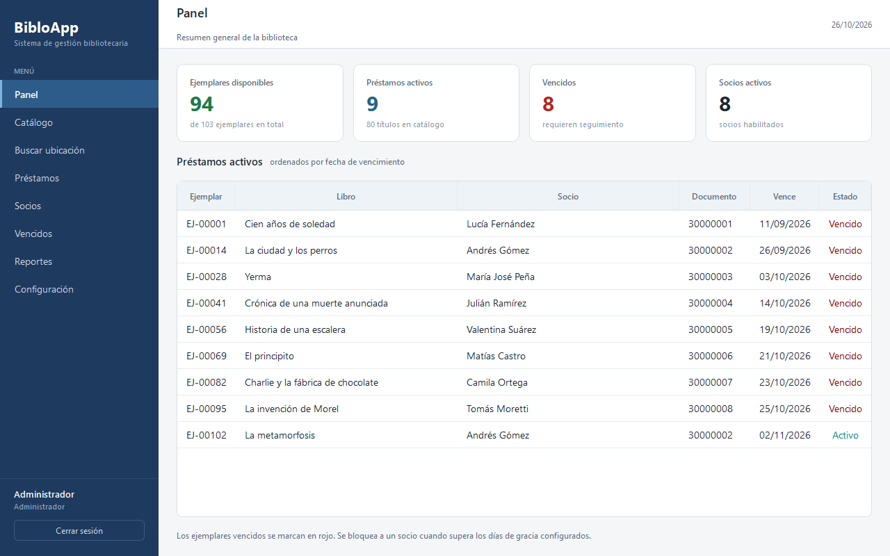

## 👋 Sobre mí

Me gusta construir software que se use de verdad. Trabajo sobre todo en **aplicaciones de escritorio**, donde la interfaz, los datos y los detalles de uso importan tanto como el código.

- 🔭 **Ahora:** desarrollando **BibloApp**, un sistema de gestión para bibliotecas pequeñas.
- 🧱 **Stack principal:** Python, PySide6 (Qt 6) y SQLite.
- 🧪 **Forma de trabajar:** pruebas automatizadas con `pytest`, documentación dentro del repositorio y cambios pequeños.
- 🌱 **También exploro:** TypeScript, Java y C#.
- 💬 **Me interesa hablar de:** Python, interfaces de escritorio, bases de datos locales y diseño de software.

## 🛠️ Stack

**Lenguajes**

**Escritorio y datos**

**Web y herramientas**

## 📚 Proyecto destacado

### BibloApp

**Gestión de bibliotecas pequeñas, sin depender de internet.**

Aplicación de escritorio para administrar catálogo, ejemplares, socios, préstamos, vencidos, multas y la ubicación física de cada libro. Todo vive en un único archivo SQLite local, con auditoría y respaldos.

- **Catálogo y ejemplares:** búsqueda por título, autor o tema, ISBN, categorías y control de disponibilidad.
- **Socios y préstamos:** fichas con historial, renovaciones, devoluciones, pérdidas y recuperaciones.
- **Vencidos y multas:** filtros por días de gracia, exportación a CSV y registro de pagos.
- **Permisos:** roles de administrador, bibliotecario y auxiliar.
- **Calidad:** 209 pruebas automatizadas con `pytest`.

| Aspecto | Detalle |
|:--|:--|
| **Interfaz** | Python + PySide6 (Qt 6) |
| **Base de datos** | SQLite local |
| **Plataforma** | Windows 10/11 |
| **Estado** | Fase 1 completa · Fase 2 en camino |

 

## 🧩 Otros proyectos

| Proyecto | Qué es |
|:--|:--|
| [**BootcampDesafio**](https://github.com/AltairCGS/BootcampDesafio) | Página que consume una API de países. JavaScript. |
| [**FundamentosPlataforma**](https://github.com/AltairCGS/FundamentosPlataforma) | Ejercicios de fundamentos de plataforma. TypeScript. |
| [**GestionConfigApp**](https://github.com/AltairCGS/GestionConfigApp) | Proyecto de gestión de la configuración. TypeScript. |
| [**Portafolio**](https://github.com/AltairCGS/Portafolio) | Portafolio personal. TypeScript. |
| [**ANOTADOR**](https://github.com/AltairCGS/ANOTADOR) | Anotador universitario. Python. |

## 📊 GitHub en números

 

## 🤝 Contacto

<!-- Cuando tengas los enlaces, descomenta y reemplaza:

-->

